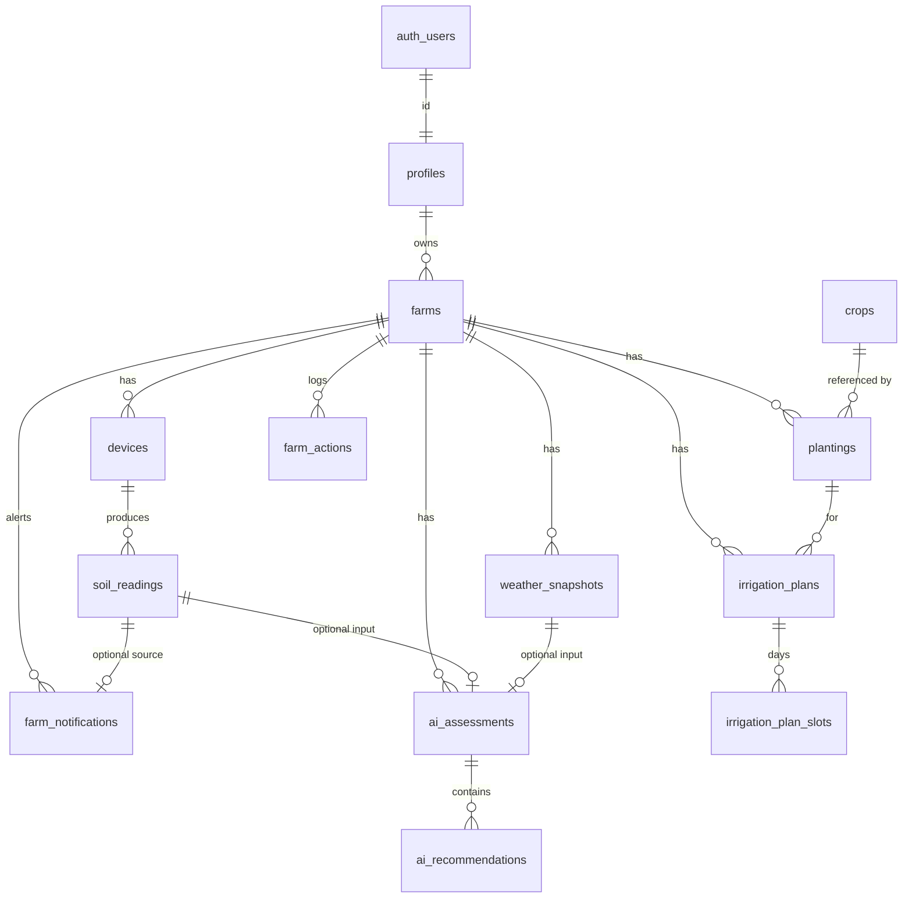
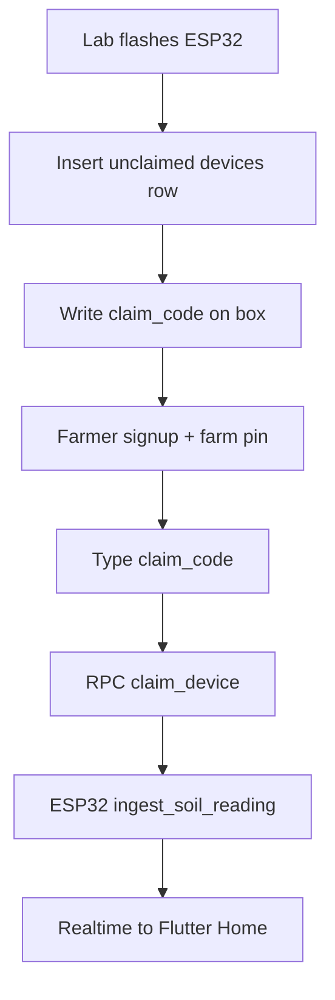

# SoilGood — Data Model

## Scope decisions
- **Auth:** Supabase Auth (login). Data follows the **user account**, not the cellphone.
- **Product scope:** 1 farm per user. That farm can hold **several ESP32 kits**. Each kit is placed on the current crop plot (`devices.planting_id`). Alerts name the sticker code: `Sensor (SG-7K2M) area is low`. SQL: [`supabase_plot_sensors.sql`](supabase_plot_sensors.sql).
- **Schema:** Normalized tables with foreign keys only (flexible if we demo a 2nd device later).
- **`crops`:** In-database **reference** data (not fetched from the internet).
- **Password:** Handled only by Supabase Auth — **no** `password` column in `profiles`.
- **Hardware status:** IoT/ESP32 may not exist yet during UI setup. Tables still apply; use **seed / mock readings** for UI development.

## Ownership / access
- User logs in → RLS allows only their own farm-related rows.
- ESP32 is linked via **claim code**: lab pre-provisions the kit; farmer types sticker `claim_code` (RPC `claim_device`). QR optional later. SoftAP/BLE WiFi is separate and later.
- ESP32 writes through RPC `ingest_soil_reading` (`device_uid` + `ingest_token`); Flutter listens via Realtime. Farmers never see `ingest_token`.

## Entity relationship

Thesis-ready **attribute-level** crow’s-foot ERD (Draw.io + export notes): [`docs/thesis/ERD.md`](../thesis/ERD.md) / [`ERD.drawio`](../thesis/ERD.drawio).

Compact relationship sketch (no attributes):



## Why each table exists
| Table | Why |
|---|---|
| `profiles` | Farmer name + address fields linked to Auth |
| `farms` | Field/location (lat/long for weather); ownership root for RLS |
| `devices` | ESP32 identity + claim_code / ingest secrets |
| `soil_readings` | Timestamped sensor history (~15 min) |
| `weather_snapshots` | Weather aligned with farm/history for advice + analytics |
| `crops` | Ideal soil ranges, days-to-maturity, and cultivation phases |
| `plantings` | What is currently planted on the farm |
| `ai_assessments` | Stored AI overview / soil health score |
| `ai_recommendations` | Structured actions (irrigation, nutrient, etc.) |
| `farm_actions` | What the farmer actually did (needed for analytics) |
| `farm_notifications` | Local soil/weather alerts (once per type per Manila day); inbox UI later |

## Tables & fields

### `profiles`
- `id` (PK, = `auth.users.id`)
- `first_name`, `last_name`
- `barangay`, `municipality_city`, `province`
- `role` — `farmer` (default) \| `admin` (Flutter web ops; SQL: [`supabase_admin.sql`](supabase_admin.sql))
- `created_at`, `updated_at`

### `farms`
- `id`, `owner_id` → `profiles.id`
- `name`
- `barangay`, `municipality_city`, `province`
- `latitude`, `longitude`
- `soil_texture` — farmer-selected texture class (`sandy` … `clay`, or `unknown`; null until onboarding step 3). SQL: [`supabase_farm_soil_texture.sql`](supabase_farm_soil_texture.sql)
- `soil_series` — optional curated BSWM/PhilRice code (`bantog` … `obando`, or `other`; null = skip). Typical feel is catalog-only. SQL: [`supabase_farm_soil_series.sql`](supabase_farm_soil_series.sql)
- `soil_series_other` — free text when `soil_series = other` (not used in match score)
- `created_at`

### `devices`
- `id`, `farm_id` → `farms.id` (**nullable** until claimed)
- `device_uid` (**unique** firmware identity)
- `ingest_token` (secret for ESP32 RPC; lab-only; not service_role)
- `claim_code` (unique short sticker code, e.g. `SG-7K2M`; SQL: [`supabase_device_claim.sql`](supabase_device_claim.sql))
- `planting_id` → `plantings.id` (nullable). Which crop plot this kit watches. Set by `place_sensor_on_plot`. SQL: [`supabase_plot_sensors.sql`](supabase_plot_sensors.sql)
- `name`, `status`, `last_seen_at`, `claimed_at`
- `flashed_at`, `flash_status` (`pending` \| `flashed` \| `error` — Lab Flasher; [`supabase_lab_flash.sql`](supabase_lab_flash.sql))
- `created_at`

### `soil_readings`
- `id`, `device_id` → `devices.id`
- `recorded_at`
- `moisture_percent`, `ph`, `soil_temperature_c`, `ec`, `salinity`
- `nitrogen`, `phosphorus`, `potassium`
- `validation_status`, `validation_message`

### `weather_snapshots`
- `id`, `farm_id` → `farms.id`
- `recorded_at`
- `temperature_c`, `humidity_percent`, `rainfall_mm`
- `rain_probability`, `wind_speed`, `weather_condition`, `source`

### `crops` (reference)
- `id`, `name`, `scientific_name`
- ideal min/max: moisture, pH, temperature, EC, salinity (NPK columns null → universal low-only in app)
- `days_to_maturity`, `phases` (jsonb: `{id, label, days}` ordered; sum = maturity)
- `range_meta` (jsonb honesty labels: `moisture_basis`, `hydro_class`, `ec_basis`, …)
- `growing_season`, `notes`
- `illustration_path` — Storage object key for one shared top-down plot picture (`crops/<file>.jpg`). Same picture for every farm that plants that crop. Files: `assets/crops/`. Seed: [`supabase_crop_illustrations.sql`](supabase_crop_illustrations.sql).
- Research + seed: [`CROP_RANGES.md`](CROP_RANGES.md), [`supabase_crop_ranges_v1.sql`](supabase_crop_ranges_v1.sql)

### `plantings`
- `id`, `farm_id`, `crop_id`
- `planted_at`, `expected_harvest_at`, `status`
  - `planned` \| `active` \| `harvested` \| `failed` \| `replaced`
  - **Change crop** sets `replaced` (not harvested — that is reserved for a real harvest later).
- **Several active crops per farm.** Each active planting is its own plot; sensors attach via `devices.planting_id`. The same crop cannot be active twice on one farm (`plantings_one_active_crop_per_farm_uidx`). Run [`supabase_plantings_one_active.sql`](supabase_plantings_one_active.sql) (status check), then [`supabase_multi_crop.sql`](supabase_multi_crop.sql) (drops the old one-per-farm index).
- The app remembers which crop the farmer is viewing (`SelectedCrop`, local prefs). Home, Farm, and Profile → Sensors follow it.

### `ai_assessments`
- `id`, `farm_id`
- `kind` — `home` \| `analytics` \| `crops` \| `crops_match` (keeps page jobs from colliding)
- `planting_id` (nullable; Crops care only — not used for `crops_match`)
- `soil_reading_id`, `weather_snapshot_id` (nullable)
- `period_days` — inclusive day count for Analytics (any ≥ 1); null for Home / Crops
- `period_start`, `period_end` — Manila calendar dates; Analytics AI cache key (this week ≠ last week even if both are ~7 days)
- `overview`, `soil_health_score`
- `generated_at`, `model_name`, `prompt_version`

### `ai_recommendations`
- `id`, `assessment_id`
- `type` — `irrigation` \| `nutrient` \| `soil_management` \| `crop_suitability` \| `crop_care`
- `title`, `description`, `priority`, `recommended_action`
- `valid_until`, `created_at`

### `farm_actions`
- `id`, `farm_id`, `created_by`
- `planting_id` (nullable → `plantings`)
- `plan_slot_id` (nullable → `irrigation_plan_slots`)
- `action_type` — `irrigation` \| `fertilizer` \| `planting` \| `treatment`
- `amount`, `unit`, `notes`, `performed_at`

### `irrigation_plans`
- Rolling horizon for one planting (rules_v1). SQL: [`supabase_irrigation_plan.sql`](supabase_irrigation_plan.sql).
- `farm_id`, `planting_id`, `horizon_start`, `horizon_days`, `story_fingerprint`, `overview`, `model_name`, `prompt_version`, `generated_at`, `valid_until`

### `irrigation_plan_slots`
- One Manila day in a plan: `action` (`water` \| `check` \| `no_water`), `confidence`, `guidance`, `reason`, `completed_action_id` (Mark watered)

### `farm_notifications`
- `id`, `farm_id` → `farms.id`
- `type` — `irrigation` \| `nutrient_low` \| `soil_alert` \| `sensor_error` \| `device_offline` \| `phase_change`
- `severity` — `info` \| `warning` \| `urgent`
- `title`, `body`
- `soil_reading_id` (nullable)
- `dedupe_key` — unique with `farm_id`; `{type}:{yyyy-mm-dd}` Asia/Manila
- `read_at` (nullable; inbox later)
- `created_at`

## Device claim flow



## ESP32 → cloud → app

```text
ESP32 sensors (~15 min)
  → HTTPS POST /rest/v1/rpc/ingest_soil_reading
    (anon key + ingest_token; never service_role)
  → soil_readings
  → Realtime
  → Flutter listener + cache/skeleton UI
```

Without hardware yet: insert **mock rows** into `soil_readings` (SQL or Table Editor) to build UI — needs a claimed device (`farm_id` set).

## What we store vs compute
- **Store:** readings, weather snapshots, crops, AI results, farm actions, farm notifications
- **Compute later (analytics):** trends, correlations, predictions via SQL on history — no extra “magic” tables required for v1

## Out of scope for v1
- Multi-farm / multi-device UI
- QR claim (type claim_code first)
- SoftAP / BLE WiFi provisioning
- Paid APIs

Future direction (QR, SoftAP/BLE, multi-ESP32 zones): [`FUTURE_ENHANCEMENTS_DEVICES.md`](FUTURE_ENHANCEMENTS_DEVICES.md).

## SQL source of truth
1. Run: [`supabase_schema.sql`](supabase_schema.sql) in the Supabase SQL Editor.
2. If project was created with **Automatically expose new tables = OFF**, also run [`supabase_grants.sql`](supabase_grants.sql) (also appended to the schema file for new installs).
3. Analytics history RPC + `period_start` / `period_end`: run [`supabase_analytics.sql`](supabase_analytics.sql).
4. Crops phases + `ai_assessments.kind`: run [`supabase_crops_home_ai.sql`](supabase_crops_home_ai.sql).
5. Per-crop ranges (17 PH crops + `range_meta`): run [`supabase_crop_ranges_v1.sql`](supabase_crop_ranges_v1.sql).
5b. Crop illustration paths: run [`supabase_crop_illustrations.sql`](supabase_crop_illustrations.sql). Upload `assets/crops/` to bucket `crop-illustrations` when the farm grid ships.
6. Alert rows: run [`supabase_notifications.sql`](supabase_notifications.sql).
7. Device claim (`claim_code` + `claim_device`): run [`supabase_device_claim.sql`](supabase_device_claim.sql).
8. Admin role + provision RPCs: run [`supabase_admin.sql`](supabase_admin.sql) (promote snippet stays commented until signup).
9. ESP32 ingest path: [`supabase_esp32_ingest.sql`](supabase_esp32_ingest.sql).
10. Optional mock reading (no ESP32): [`supabase_seed_soil_reading.sql`](supabase_seed_soil_reading.sql) — needs a claimed device.
11. Irrigation plans + Mark watered FKs + `crop_care` tip type: [`supabase_irrigation_plan.sql`](supabase_irrigation_plan.sql).
12. Catalog AI match kind (`crops_match`): [`supabase_crops_match_ai.sql`](supabase_crops_match_ai.sql).

### Verification notes (2026-07-25)
- Auth signup works with the **legacy anon JWT** (`eyJ...`).
- New `sb_publishable_...` key authenticated Auth health but REST returned 401 in our tests — use **legacy anon key** for Flutter for now.
- Without GRANTs, logged-in insert failed: `permission denied for table farms` (hint: GRANT to `authenticated`). RLS was not the blocker.

## Open decisions
- ESP32 write path: Edge Function vs constrained insert
- Weather write timing: with each reading vs scheduled
