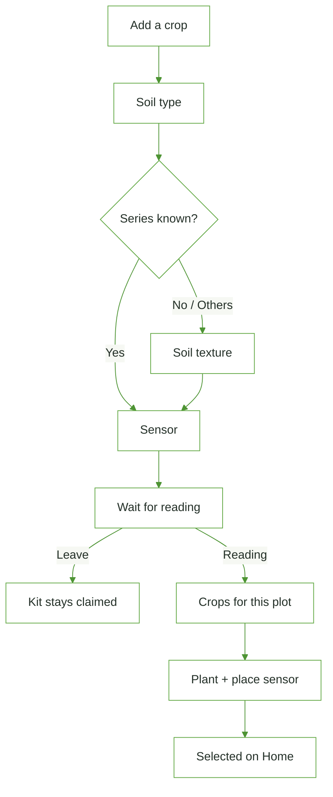

# Page: Add a crop (wizard)

## Status
- [ ] Planned
- [x] In progress
- [ ] Done

## Purpose / goal
A new plot has no data yet, so crop matches from the farm-wide reading are not honest. Ask about the plot first (soil + the sensor in that soil), wait for that sensor's first reading, then rank crops for **this plot**.

## User flow
- Opened from **Home → Your crops → Add a crop** or **Farm → + Add crop** (pushed, slide from right).
- **Soil type:** BSWM series or **Not sure**. The farm's series is pre-selected ("Same as your farm"). **Others** asks for a name.
- **Soil texture:** asked **only** when the series is Not sure / Others (same fallback as onboarding). A curated series uses its typical texture.
- **Sensor (required):** type the sticker code (claimed onto the farm, no plot yet) or pick a kit that is not on a plot. Kits on another crop are disabled.
- **Waiting:** live watch on `soil_readings` for that kit. Readings up to 20 min before confirming count. "Check now" and pull also fetch. "I'll come back later" leaves; the kit stays claimed and shows next time as "Not on a plot yet".
- **Crop matches** (`CropsPage(plot:)`): this plot's reading + soil + weather. Crops already growing are hidden.
- **Plant:** inserts the planting with `soil_texture` / `soil_series`, places the sensor on it, selects it on Home, closes the wizard.

## Data & sources
- `farms.soil_series` / `soil_texture` (defaults only).
- `devices` via `PlotSensorsRepository.listForFarm` / `claimToFarm`.
- `soil_readings` stream filtered by `device_id` (`watchReadingSince`).
- `plantings.soil_texture`, `soil_series`, `soil_series_other` — run [`supabase_multi_crop.sql`](../context/supabase_multi_crop.sql).

## UI states
| State | What the user sees |
|---|---|
| Skeleton | Muted card while farm soil + kits load |
| Step | Step header, radio cards, Next at the end of the scroll |
| Error | Banner above Next (claim failed, kit already on a crop) |
| Waiting | Plot summary + spinner + Check now / come back later |
| Reading received | Check icon + "See crops for this plot" |

## Functions
| Function | What it does | When called |
|---|---|---|
| `_loadFarm()` | Farm soil defaults + kits | Open, pull on steps 1–3 |
| `_sensorNext()` | Claim typed code or use picked kit | Use this sensor |
| `_startWaiting()` | Live watch + one fetch | After sensor |
| `_openMatches()` | Push `CropsPage(plot:)`; pop `true` if planted | First fresh reading / button |

## Page logic flowchart

## Related
- [Home](home.md) crop picker, [Farm](farm.md) "+ Add crop".
- Mock: `docs/mocks/farm_switcher/add-crop-wizard.html`.
