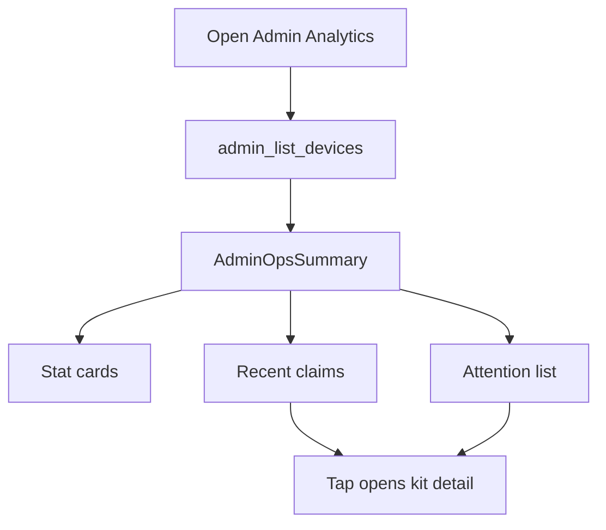

# Page: Admin Analytics (Flutter Web)

> Ops overview for SoilGood kits. Not the farmer Analytics tab (soil trends / period AI).

## Status
- [x] Done

## Purpose / goal
Give an **admin** a quick kit-pipeline health view: provision → flash → claim → online — without reading farmer soil data.

## User flow
- AdminShell first nav item: **Analytics**
- Stat cards: total, unclaimed, active, offline, flashed, not flashed
- Recent claims list (tap → device detail)
- Attention list (not flashed / offline / waiting claim / never seen)
- Pull-to-refresh reloads `admin_list_devices` only

## Data & sources
- Same inventory as Devices: `admin_list_devices` (includes `flashed_at` after [`../context/supabase_lab_flash.sql`](../context/supabase_lab_flash.sql))
- Client-side summary: `AdminOpsSummary` — no extra RPC, no soil tables

## UI states
| State | What the user sees |
|---|---|
| Skeleton | Spinner on first load |
| Cached | Last inventory kept on pull fail |
| Live | Refetched counts + lists |
| Refreshing | Pull spinner; keep last-known |
| Empty | Zeros + “No claims yet” / “No kits need attention” |
| Error | Visible banner |

## Optimistic UI
None — read-only overview.

## Functions
| Function | What it does | When called |
|---|---|---|
| `listDevices()` | Inventory | Open / pull |
| `AdminOpsSummary.fromDevices()` | Derive cards + lists | After fetch |

## Page logic flowchart

## Related
- Mock: [`../mocks/admin_ops_analytics_mock.html`](../mocks/admin_ops_analytics_mock.html)
- Devices: [`admin_devices.md`](admin_devices.md)
- Lab Flasher: [`lab_flasher.md`](lab_flasher.md)
