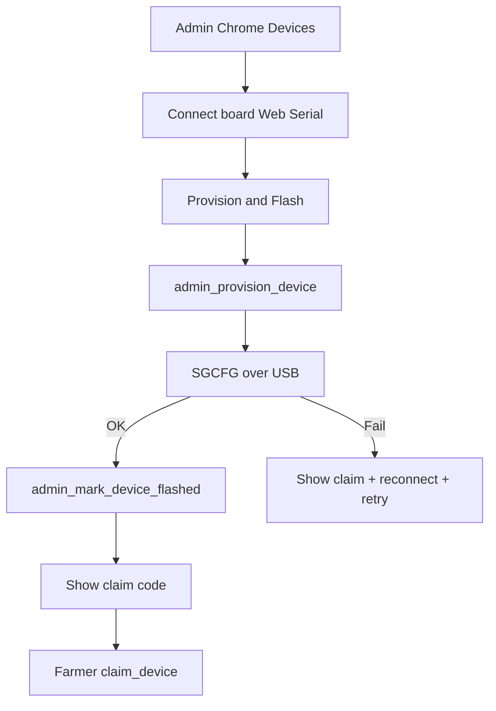

# Page: Admin Devices (Flutter Web)

> Ops console for provisioning SoilGood kits. Not a farmer shell tab.

## Status
- [x] Done

## Purpose / goal
Let an **admin** create unclaimed devices and **flash credentials over USB from Chrome** (Option B — Web Serial), then hand claim codes to farmers.

## User flow
- Admin chrome: **Analytics** + **Devices** + **Profile**.
- Devices: **Provision & Flash** (primary)
  1. Label (optional) + lab WiFi SSID/password
  2. **Connect board** (Chrome serial picker) — required before provision
  3. **Provision & Flash** → `admin_provision_device` → SGCFG over USB → `admin_mark_device_flashed`
  4. Success card: big claim code
- List shows status + **Flashed:** date or *Not flashed*
- Pull-to-refresh on inventory

**Backup:** Windows Lab Flasher (`tooling/lab_flasher`) — same SGCFG protocol. Manual secrets.h still possible.

**Chrome only** for Web Serial (Edge OK). Not Safari/Firefox.

## Data & sources
- RPCs: `admin_list_devices`, `admin_provision_device`, `admin_get_device`, `admin_mark_device_flashed`
- Web Serial: [`../../web/soilgood_serial.js`](../../web/soilgood_serial.js)
- Lab WiFi remembered in `localStorage` (browser)

## UI states
| State | What the user sees |
|---|---|
| No Web Serial | Red banner — use Chrome |
| No port | Red port pill; Flash disabled |
| Busy | Spinner + status line |
| Success | Claim code card |
| Flash fail after provision | Claim code + Retry flash (reconnect) |

## Functions
| Function | What it does | When called |
|---|---|---|
| `requestPort()` | Chrome USB picker | Connect board |
| `injectConfig()` | SGCFG line @ 115200 | After provision |
| `provisionDevice()` | Create unclaimed kit | Primary button |
| `markFlashed()` | Set flashed_at | After SGCFG_OK |

## Page logic flowchart

## Related
- Mock (desktop flasher UX twin): [`../mocks/lab_flasher_mock.html`](../mocks/lab_flasher_mock.html)
- Analytics: [`admin_analytics.md`](admin_analytics.md)
- Lab Flasher backup: [`lab_flasher.md`](lab_flasher.md)
- Firmware SGCFG: [`../../firmware/esp32/soilgood_heartbeat/README.md`](../../firmware/esp32/soilgood_heartbeat/README.md)
