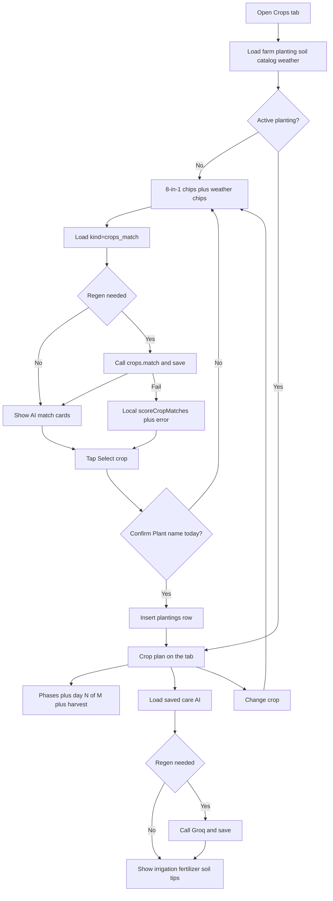

# Page: Crops

## Status

- [ ] Planned

- [x] In progress (AI catalog match + planting plan + water week + care)

- [ ] Done

## Purpose / goal

Help the farmer pick a crop that fits the **latest** soil snapshot, then follow a cultivation plan (phase, days to harvest, **rolling water plan**, phase care tips).

Not a history page. Monthly / seasonal fit from past readings belongs on [Analytics](analytics.md).

## User flow

- Opened from Farm **Choose a crop** (pushed page, not a shell tab).

- **No selected crop:** all **8-in-1** soil chips + this week’s weather chips + ranked catalog matches (AI scores grounded on catalog ranges + soil + forecast; ≥50% preferred, else best under-50%). Tap **Select crop** → confirm **Plant {name} today?** → plant it (today) → this page closes and Farm shows the plan under that area.

- **Has selected crop** (only if a planting already exists when this page opens): the same plan panel as Farm. **Change crop** returns to this list.

- **Pull-to-refresh** the page (vertical). Phase strip stays horizontal-only.

## In / out (locked)

**On Crops**

- **Farm soil line (list mode):** display-only full-width row `Texture · Series` (e.g. `Loam · Bantog`) when the farm has texture and/or a curated series. Not editable here — Profile / onboarding. Hidden when both unset.

- Latest **8-in-1** soil chips + Open-Meteo chips for matching.

- **Catalog match:** Groq `crops.match` ranks crops from **local grounded facts** (catalog min/max, bands, season, rain, **farm soil series if set else soil texture**). Local `scoreCropMatches` is fallback only if AI fails.

- One active planting per farm.

- Timeline from `planted_at` + catalog phases.

- **Water plan:** 7-day **horizon** (not 7 waterings). Actions `water` | `check` | `no_water` from soil + drying trend + forecast + phase + last irrigation. Rules engine (`irrigation_rules_v1`); replan on story fingerprint / day roll / `valid_until`. Preserve Done slots.

- **Mark watered:** Today only on Crops. Writes `farm_actions` + links slot. No Skip. No Mark watered on Home.

- Groq **care** = phase chores only (`soil_management`); no water/NPK orders here.

**Not on Crops**

- Farm diary UI / abono log / phase checklist (removed from scope).

- Home’s Quick Insight banner.

- Analytics kalagayan / historical seasonal fit.

## Data & sources

- **Soil chips:** `SoilReadingsRepository.fetchLatest` (same latest row as Home; no month load). All eight probe fields.

- **Weather chips + match:** live Open-Meteo at the farm pin (same service as Home). Fetched on first load and pull, even before a crop is selected. Fail visibly; match still runs (AI or local).

- **Catalog:** `public.crops` (8-in-1 ranges + `growing_season` + `scientific_name` + `days_to_maturity` + `phases` jsonb). SQL: [`../context/supabase_crops_home_ai.sql`](../context/supabase_crops_home_ai.sql) + [`../context/supabase_crop_ranges_v1.sql`](../context/supabase_crop_ranges_v1.sql).

- **Selected crop:** `public.plantings` (`status = active`). Select = confirm then insert (`planted_at` = Manila today). Change = confirm then set `replaced`. DB allows at most one active per farm.

- **Match AI:** load latest `ai_assessments` where `kind = 'crops_match'`. Call Edge Function `soilgood-insights` (`job=crops.match`) only if none saved, soil reading changed, weather story fingerprint changed, `valid_until` passed, or prompt version changed. SQL kind: [`../context/supabase_crops_match_ai.sql`](../context/supabase_crops_match_ai.sql).

- **Care AI:** load latest `ai_assessments` where `kind = 'crops'` and `planting_id` matches. Call `job=crops.care` only if none saved, soil reading changed, `valid_until` passed, phase changed, or prompt version changed. Phase chores only (`soil_management`). No reading → no Groq call.

- **Water plan:** `irrigation_plans` / `irrigation_plan_slots` via `IrrigationPlanRepository`. Rebuild with `IrrigationPlanBuilder` when fingerprint / day / expiry changes. SQL: [`../context/supabase_irrigation_plan.sql`](../context/supabase_irrigation_plan.sql).

- First open: skeleton. Pull: keep last-known. Groq waits until the page is visible (`TickerMode`) so a hidden tab does not bill on every app open.

- Realtime: plantings, soil, farms, saved match AI, and the catalog refresh this page while it is open. Same hub as the rest of the shell. SQL: [`../context/supabase_realtime.sql`](../context/supabase_realtime.sql).

## UI states

| State | What the user sees |

|---|---|

| Skeleton | First open only — chips + cards placeholders |

| Cached | Last-known list or plan during pull |

| Live | After fetch |

| Refreshing | Page-level `RefreshIndicator`; ~15s data timeout; Groq ~20s |

| Empty | No reading, no catalog, or zero scored crops — visible message. Match list: ≥50% only when any qualify; else best under-50% (top 8) |

| Error | Per-source (soil / catalog / planting / AI). Match AI fail → local scores + visible error. Plan can show while care AI fails |

## Optimistic UI

| Action | Optimistic change | On failure |

|---|---|---|

| Select crop | Confirm → show plan immediately | Rollback to list + visible error |

| Change crop | Confirm → return to list | Restore plan + visible error |

## Functions

| Function | What it does | When called |

|---|---|---|

| `_reloadAll()` | Farm, planting, soil, catalog, weather; then match AI (no planting) or care AI (planted) | `TickerMode` first visible, pull |

| `_selectCrop()` | Confirm, then insert active planting | Tap Select crop → confirm |

| `_changeCrop()` | Confirm, then mark planting `replaced` | Confirm Change crop |

| `buildCropMatchCatalogFacts()` | Local grounded per-crop facts for Groq | Before `crops.match` |

| `_loadMatchAi()` | Load saved `crops_match`; Groq + save if regen | After list-mode load |

| `scoreCropMatches()` | Local % fallback when AI fails | AI error / timeout |

| `timelineFor()` | Day N / current phase / harvest date | When a planting exists |

| `_loadCareAi()` | Load saved crops AI; Groq + save if regen | After successful plan load |

## Page logic flowchart

## Related

- Shell: Home / Analytics / Crops / Profile.

- Groq setup: [BACKEND.md](../context/BACKEND.md) / [AI_INSIGHTS.md](../context/AI_INSIGHTS.md). Key is an Edge Function secret, not `.env`.

- Rules: `.cursor/rules/page-architecture/responsive-ui.mdc`, `pull-to-refresh.mdc`.

