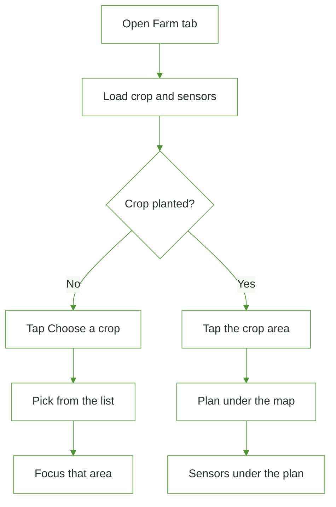

# Page: Farm map

## Status
- [ ] Planned
- [x] In progress
- [ ] Done

## Purpose / goal
Show the farmer's farm as a picture map. The farm can grow several crops at once; each crop is its own plot with its own sensors. Tapping a crop shows its plan underneath: phases, water week, care, then the sensors on that plot.

## User flow
- Open the Farm tab.
- Chips: Overview, one chip per planted crop, then **+ Add crop**. A crop chip makes that crop the selected crop (Home follows it too).
- Tap the crop. The tile grows. Under it: the crop plan (phases, 7-day water, care, Change crop, Mark watered), then every sensor on that crop (`Sensor (SG-7K2M)`).
- **Choose a crop** / **+ Add crop** opens the [Add a crop wizard](add-crop.md): soil type → (texture) → sensor → first reading → crops for that plot. After planting, the new crop is selected.
- **Change crop** ends the planting and opens the crop list again.
- **Add sensor** types a new sticker code and places that kit on this crop.
- A kit claimed in onboarding with no plot yet asks **Place on {crop}**.
- Pull-to-refresh reloads the farm name, the active planting, the sensors, and the open plan (saved care and water; the model runs only when the story changed).

## Data & sources
- `farms.name` and the primary farm id from Supabase.
- Active `plantings` row joined to `crops`. Loaded on open, pull, and Realtime. Run [`supabase_realtime.sql`](../context/supabase_realtime.sql) once so plantings, sensors, AI, and irrigation are in the publication.
- Care insights and the rolling water plan reload when those rows change. Open-Meteo is not a database table; it refreshes with soil and pull.
- Plot pictures from `assets/crops/`, one shared tile per catalog crop.
- Several active plantings per farm (`fetchActivePlantings`). Selected crop is shared through `SelectedCrop`. Needs [`supabase_multi_crop.sql`](../context/supabase_multi_crop.sql).

## UI states
| State | What the user sees |
|---|---|
| Skeleton | A muted card the shape of the map |
| Cached | Last farm name and planting stay on screen during pull |
| Live | Name, crop tile, and the plan under the focused crop |
| Refreshing | Spinner over the last map. The plan keeps its last care and water text |
| Empty | Sensor tile plus "Choose a crop" |
| Error | The error text stays visible. A later success replaces it |

## Optimistic UI
| Action | Optimistic change | On failure |
|---|---|---|
| Tap an area | The grid focuses that tile immediately | Local only — nothing to roll back |
| Change crop | The area clears after the planting ends, then the crop list opens | The plan stays and shows the error |
| Mark watered | The week reloads after the log is saved | The error shows on the water card |

## Functions
| Function | What it does | When called |
|---|---|---|
| `_load()` | Farm name + active planting + sensors. Bumps the plan refresh | First open and pull |
| `_openCropPicker()` | Pushes the crop list. On plant, reloads and focuses the crop | Choose a crop, and after Change crop |
| `CropPlanPanel` | Phases, water week, care for the focused crop | Tap the planted area |

## Page logic flowchart

## Related
- Home quick stat "Farm" selects this tab.
- Crops list is the pushed picker. The plan itself stays on this tab.
- Pictures: `assets/crops/` and `docs/context/supabase_crop_illustrations.sql`.
