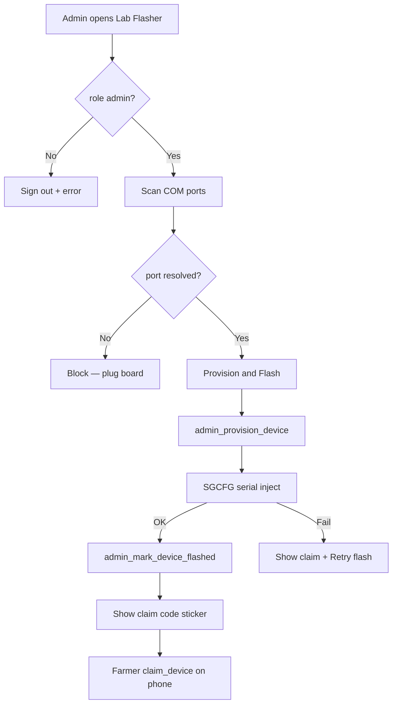

# Page: Lab Flasher (Windows desktop) — **backup**

> Optional USB station. **Primary flash path is Admin Web Option B** (Chrome Web Serial on Devices). Keep this app if Web Serial fails or you prefer desktop.

## Status
- [x] Done (backup)

## Purpose / goal
Same job as Admin **Provision & Flash**: create unclaimed kit + write credentials over USB — via Windows/`flutter_libserialport` instead of browser Web Serial.

## User flow
- Sign in with `profiles.role = admin` (same Supabase Auth as SoilGood).
- Optional kit label.
- Port: **auto-detect** when exactly one ESP-looking COM port; **dropdown** if 0 ambiguous / 2+.
- Primary button: **Provision & Flash**
  1. Fail early if no port (do **not** provision)
  2. `admin_provision_device`
  3. Serial `SGCFG|{json}|` @ 115200 → wait `SGCFG_OK`
  4. `admin_mark_device_flashed`
  5. Success card: big claim code + “Unplug · sticker”
- If flash fails after provision: keep claim code + **Retry flash only**
- No permanent dark terminal; optional “Technical details”

Pull-to-refresh: **not required** (desktop station, not a data-list tab). Port has Refresh.

## Data & sources
- Supabase RPCs: `admin_provision_device`, `admin_mark_device_flashed` ([`../context/supabase_lab_flash.sql`](../context/supabase_lab_flash.sql), admin SQL).
- Local `.env`: `SUPABASE_*`, `WIFI_SSID`, `WIFI_PASSWORD` (burned into NVS).
- USB serial via `flutter_libserialport`.

## UI states
| State | What the user sees |
|---|---|
| Login | Email/password |
| Ready | Port pill + Provision & Flash |
| No port | Red pill; button disabled |
| Busy | Spinner on button; short status line |
| Success | Green card with claim code |
| Error | Visible error; claim code if already provisioned |

## Optimistic UI
| Action | Optimistic change | On failure |
|---|---|---|
| Provision & Flash | Wait for each step | Show error; preserve claim if provisioned |

## Functions
| Function | What it does | When called |
|---|---|---|
| `SerialPortService.scan()` | List / auto-pick COM | Open / Refresh |
| `FlashRepository.provision()` | Create unclaimed kit | Primary button |
| `SerialConfigInjector.inject()` | Send SGCFG; wait OK | After provision |
| `FlashRepository.markFlashed()` | Set flashed_at | After SGCFG_OK |

## Page logic flowchart

## Related
- **Primary:** Admin Web Provision & Flash — [`admin_devices.md`](admin_devices.md)
- Code: [`../../tooling/lab_flasher/`](../../tooling/lab_flasher/)
- Mock: [`../mocks/lab_flasher_mock.html`](../mocks/lab_flasher_mock.html)
- Firmware: [`../../firmware/esp32/soilgood_heartbeat/`](../../firmware/esp32/soilgood_heartbeat/)
- Claim onboarding: [`onboarding.md`](onboarding.md)
