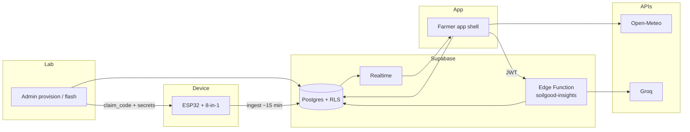
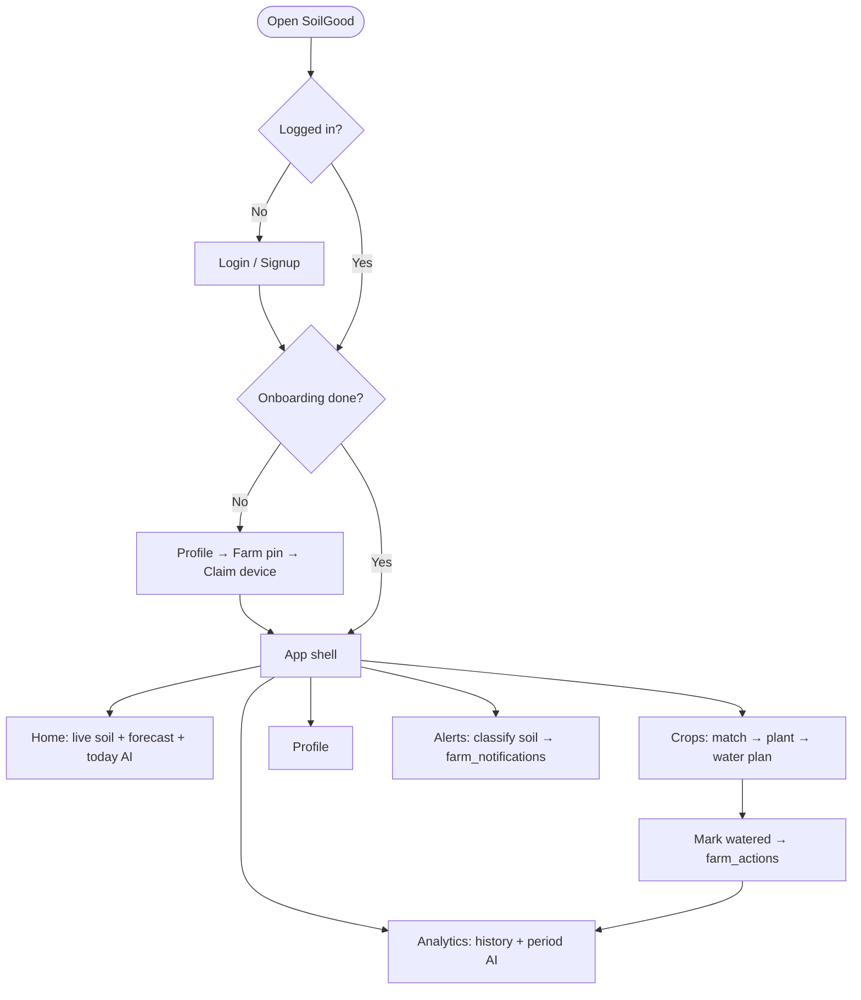
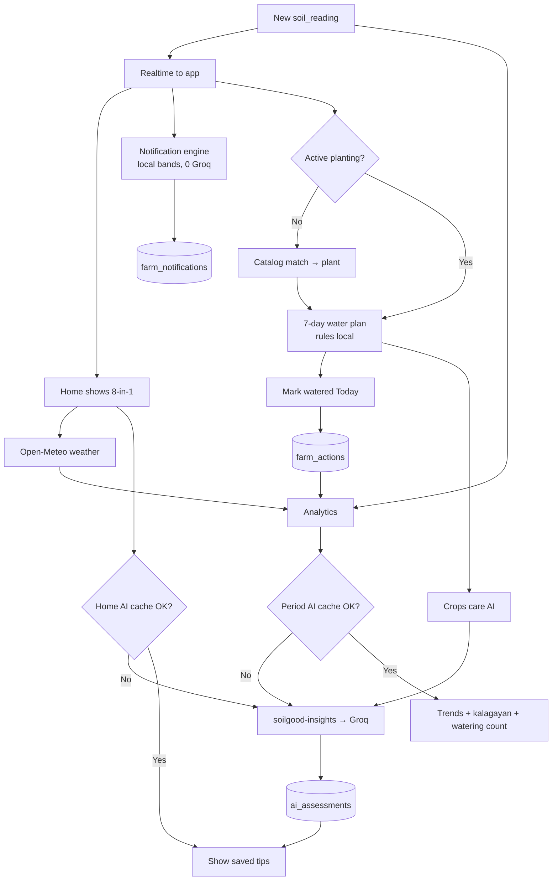

# SoilGood — System flowchart (Mermaid)

Medium detail: enough for thesis / defense talk-through, not every cache/edge case.

**View:** paste into [mermaid.live](https://mermaid.live), or open this file with a Mermaid preview in Cursor/VS Code.

Print PDF / Draw.io (more detail): [`SYSTEM_FLOWCHART.pdf`](SYSTEM_FLOWCHART.pdf) · [`SYSTEM_FLOWCHART.drawio`](SYSTEM_FLOWCHART.drawio)

---

## 1. System overview

Who talks to whom (hardware → cloud → app → AI/weather).

---

## 2. Farmer journey → daily use

Setup once, then the four tabs (+ alerts + farmer log).

---

## 3. Operational loop (with farmer logs)

The closed loop while the app is in use — sensing, advice, logging, learning.

---

## How to read this (1 minute)

| Piece | Meaning |
|-------|---------|
| **Home** | *Now* — latest soil, forecast, today tips |
| **Crops** | Match crop, water week, **Mark watered** log |
| **Analytics** | *Over time* — history + uses `farm_actions` counts |
| **Alerts** | Local bands → `farm_notifications` (not Groq) |
| **Groq** | Only when AI cache / fingerprint says regenerate |

Caption idea: *Figure X. SoilGood system flowchart: device ingest, farmer app tabs, AI insights, and irrigation action logs.*
